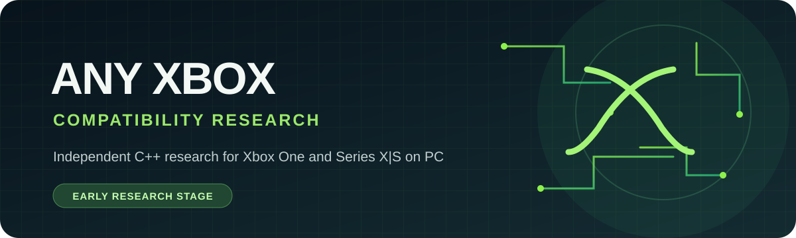
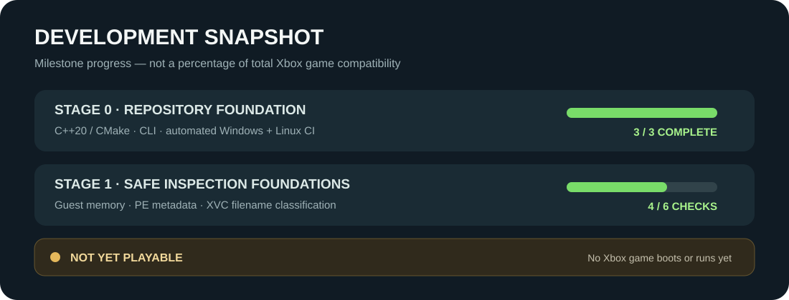
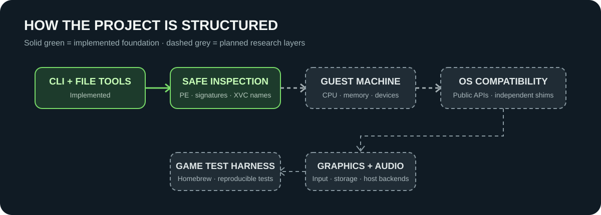

# Any Xbox

<p align="center">
  
</p>

<p align="center">
  <a href="https://github.com/MuhammedAmeerHamza/any-xbox/actions/workflows/ci.yml"></a>
  
  
  
  
</p>

**An independent C++ research project exploring what it would take to make Xbox One and Xbox Series X|S software compatible with Windows PCs.**

> [!IMPORTANT]
> **Early development preview — not compatible with commercial Xbox games yet.** Any Xbox now includes a small, bounded x86-64 interpreter that executes a deliberately limited instruction subset from synthetic guest memory, plus an interactive guest-code number-game demo. This proves a first guest-code execution path only; it does not load Xbox executables or run Xbox One / Series X|S games.

## Development snapshot

<p align="center">
  
</p>

Progress is reported by **completed roadmap checks**, not as a percentage of the entire goal. Completing the repository foundation does not mean game compatibility is close to complete.

| Area | Current status |
|---|---|
| Repository foundation | Complete — 3/3 Stage 0 checks |
| Safe inspection foundations | Complete — 6/6 Stage 1 checks |
| x86-64 guest CPU | Register / RIP / RFLAGS model plus a limited, interpreted instruction subset |
| Execution backend | Bounded x86-64 subset interpreter; not an Xbox execution backend |
| Guest timing and exceptions | Abstract deterministic ticks and normalized pending-exception bookkeeping; not Xbox hardware accurate |
| Interrupts and devices | Bounded generic interrupt queue and checked synthetic device bus; no Xbox hardware implementation |
| Xbox OS compatibility | Not implemented |
| Graphics, audio, input and storage runtime | Not implemented |
| Running Xbox One / Series X|S games | Not implemented |

See the detailed [roadmap](docs/ROADMAP.md) and [compatibility report](docs/COMPATIBILITY_REPORT.md).

## What works today

- `xboxlab --help` — command-line help.
- `xboxlab --inspect <file>` — reads at most the first 16 bytes and recognises MZ/PE, XEX2, ZIP, and ELF signatures.
- `xboxlab --inspect-pe <file>` — reads up to 1 MiB and validates basic DOS, PE signature, COFF, optional-header, and section-table bounds. Reports generic machine type, section count, timestamp, optional-header kind, characteristics, subsystem value, and section metadata.
- `xboxlab --inspect-manifest <file>` — safely inspects a bounded subset of MicrosoftGame.config metadata, including identity, executable entries, and optional IDs; not a full schema validator.
- `xboxlab --inspect-package <file>` — classifies documented XVC filename suffixes: `_x.xvc` as Xbox One family and `_xs.xvc` as Xbox Series X|S family. It does not parse package contents.
- `xboxlab --play-demo` — runs a small interactive number game whose comparison and win/loss decision execute as synthetic x86-64 guest instructions inside the interpreter.
- `GuestMemory` — a host-independent, bounds-checked guest address-space model with mapped regions and explicit read/write/execute permissions.
- `GuestCpuState` — x86-64 general-purpose register, instruction-pointer, and selected flags model used by the interpreter.
- `X64InterpreterBackend` — executes a deliberately limited instruction subset: `MOV r32, imm32`, `CMP EAX, imm32`, short `JE/JNZ/JMP`, `NOP`, and a controlled `HLT` test stop. Every run has an instruction budget and explicit stop reason. This is not a complete x86-64 CPU and does not execute Xbox binaries.
- `GuestTiming` — deterministic abstract virtual ticks with overflow checks; not calibrated to real hardware.
- `GuestExceptionState` — one pending normalized exception record; no CPU exception delivery.
- `GuestInterruptController` — bounded FIFO of normalized interrupt requests; no hardware vector or priority model.
- `GuestDevice` / `GuestDeviceBus` — synthetic device interface and checked guest address routing; no real Xbox hardware devices.
- C++20 / CMake build and automated tests on Windows and Linux through GitHub Actions.

### Important technical limits

The XVC classifier checks a **filename convention only**. It does not verify package contents, signatures, encryption, title identity, installability, or compatibility. A generic PE header does not prove that a file is an Xbox executable. The PE inspector does not parse imports, relocations, Xbox package internals, or execute code. `GuestMemory` is a testable data model, not a CPU or game runtime. Timing ticks are abstract, and exception records do not implement hardware exception delivery.

## Architecture

<p align="center">
  
</p>

The green blocks are implemented foundations. Dashed blocks are future research layers, not working features. The new interpreter is a tiny execution proof, not Xbox compatibility.

## Project goals

- Research Xbox One and Xbox Series X|S as distinct generations.
- Build independent tools using public documentation and lawful test material.
- Investigate executable formats, CPU/runtime requirements, OS interfaces, graphics, audio, input and storage.
- Prove each capability with synthetic tests and reproducible homebrew test programs before making compatibility claims.

The project is inspired by the general idea of native compatibility work, but it is independently implemented. We do not copy code from AnyPS5 or other projects.

## Build it

Requirements: CMake 3.20+ and a C++20 compiler (Visual Studio 2022, recent Clang, or GCC).

### Windows 11

Install Visual Studio 2022 with the **Desktop development with C++** workload and CMake. Open Developer PowerShell in the repository:

```powershell
cmake -S . -B build
cmake --build build --config Release
.\build\Release\xboxlab.exe --help
ctest --test-dir build -C Release --output-on-failure
```

### Linux

```bash
sudo apt install build-essential cmake
cmake -S . -B build -DCMAKE_BUILD_TYPE=Release
cmake --build build -j2
./build/xboxlab --help
ctest --test-dir build --output-on-failure
```

Example commands:

```bash
xboxlab --inspect-pe path/to/sample.exe
xboxlab --inspect-package Package_xs.xvc
xboxlab --play-demo
```

The demo is synthetic and contains no Xbox game files. It is the first end-to-end proof that Any Xbox can fetch, decode, and execute a small guest instruction sequence.

## Repository map

| Folder / file | Purpose |
|---|---|
| `include/xboxlab/` | Public C++ interfaces |
| `src/` | Implementations and CLI |
| `tests/` | Automated tests |
| `docs/` | Architecture, roadmap and compatibility reports |
| `assets/` | Project banner and diagrams |
| `compatibility/` | Future per-title test reports |

## Research and safety principles

- Use public documentation, independently developed code, and lawfully obtained test material.
- Do not bundle commercial games, firmware, console keys, proprietary SDKs, or copyrighted system libraries.
- Do not bypass console security, DRM, or access controls.
- Keep compatibility claims specific, reproducible, and backed by tests.
- Preserve attribution and comply with third-party licences.

## Contributing

See [CONTRIBUTING.md](CONTRIBUTING.md). Small, documented, testable contributions are welcome.

## Licence

MIT. See [LICENSE](LICENSE). Third-party components introduced later may have separate licences and notices.
