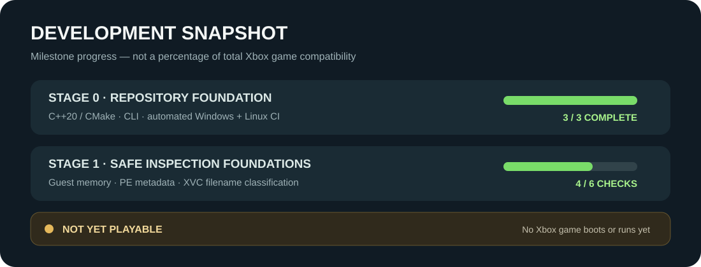

# Development roadmap

Any Xbox is an early-stage research foundation. It is not yet an emulator, executable porting tool, or game launcher.

  

Progress counts checklist items inside each stage only. It is not a percentage of the complete goal of running Xbox games.

## Target scope

- Xbox One: active research target.
- Xbox Series X|S: active research target and long-term priority.
- Keep generation-specific formats, metadata, and runtime assumptions separate.

## Stage 0 — repository foundation
- [x] C++20 / CMake project
- [x] CLI and file signature inspection
- [x] Automated tests and Windows/Linux CI

**Stage status: 3/3 checks complete.**

## Stage 1 — safe inspection foundations
- [x] Initial bounds-checked guest memory regions
- [x] Basic PE/COFF header and section-table inspection with malformed-input tests
- [x] Documented XVC filename generation classification
- [x] Bounded PE section-header metadata parsing
- [x] Safe bounded parsing of documented MicrosoftGame.config metadata
- [x] Add libFuzzer coverage and synthetic non-copyrighted manifest fixtures

**Stage status: 6/6 checks complete.**

## Stage 2 — machine model
- [x] Define a tested x86-64 guest register / RIP / RFLAGS state model
- [x] Define a bounded instruction execution backend interface and explicit stop reasons
- [x] Add deterministic virtual guest ticks and a single-pending normalized exception state
- [x] Define bounded interrupt requests and a checked guest device bus
- [x] Implement a bounded x86-64 interpreter subset and execute a synthetic guest program

**Stage status: 5/5 checks complete.**

The timing counter uses abstract ticks only; it is not calibrated to Xbox hardware. The exception state is bookkeeping only. The interrupt queue does not implement hardware vector delivery or priority, and the device bus contains no real Xbox hardware map. The interpreter supports only a small instruction subset and does not run Xbox executables. Xbox One and Series X|S runtime differences must be researched before hardware-specific assumptions are introduced.

## Stage 3 — compatibility research
- [ ] Document publicly observable OS interfaces
- [ ] Implement independent API shims where technically and legally appropriate
- [ ] Design graphics, audio, input and storage abstractions
- [ ] Add per-title test harness

## Stage 4 — proof of capability
- [ ] Run purpose-built homebrew test programs
- [ ] Publish reproducible logs and compatibility evidence
- [ ] Evaluate title compatibility only with lawful user-provided material

No stage guarantees that modern commercial Xbox games will become compatible. Performance and compatibility depend on the target hardware, title, and completeness of the implementation.

### Chapter 4 — deterministic timing and exception bookkeeping

Implemented a deterministic abstract tick counter with overflow protection and a minimal pending-exception record. These are testable foundations only: no hardware-accurate Xbox timing, timer interrupts, CPU exception delivery, interrupt controller, or production execution backend exists yet. Next, research interrupt and device abstractions using public documentation.

### Chapter 5 — interrupt and device abstractions

Added a bounded FIFO for normalized interrupt requests and a guest device interface with a checked address-range bus. Tests cover queue capacity and ordering, invalid and overlapping device registrations, mapped reads/writes, and out-of-range access. These are generic interfaces only; no Xbox interrupt controller or real hardware devices are implemented.

### Chapter 6 — manifest metadata and parser hardening

Added bounded read-only inspection for a documented MicrosoftGame.config subset, synthetic manifest fixtures, malformed XML/security-boundary tests, and a Clang libFuzzer target covering both PE and manifest parsers. The manifest parser is not a full XSD validator and does not inspect or decrypt XVC package contents. Fuzzing in CI is a bounded smoke session, not proof that all parser defects are absent.

### Chapter 7 — first guest instruction execution

Implemented the first bounded x86-64 interpreter subset and an interactive synthetic guest-code number game. The interpreter fetches instructions from `GuestMemory`, supports immediate 32-bit register moves, `CMP EAX, imm32`, short conditional/unconditional branches, `NOP`, and a controlled `HLT` test stop. Tests verify correct and incorrect comparison paths, instruction-budget enforcement, unsupported-opcode reporting, and unmapped instruction fetches.

This is the first actual guest-instruction execution in the repository, but it is not an Xbox game runtime. No PE/Xbox executable loader, import resolver, Xbox OS services, graphics, audio, or controller integration exists yet. The synthetic demo is a proof of the interpreter path only.
